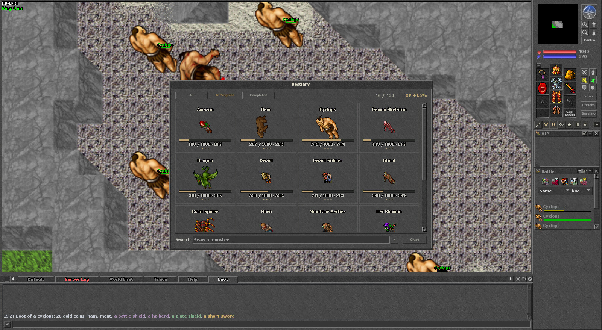
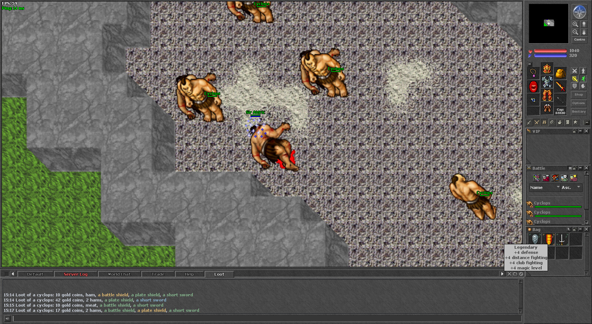
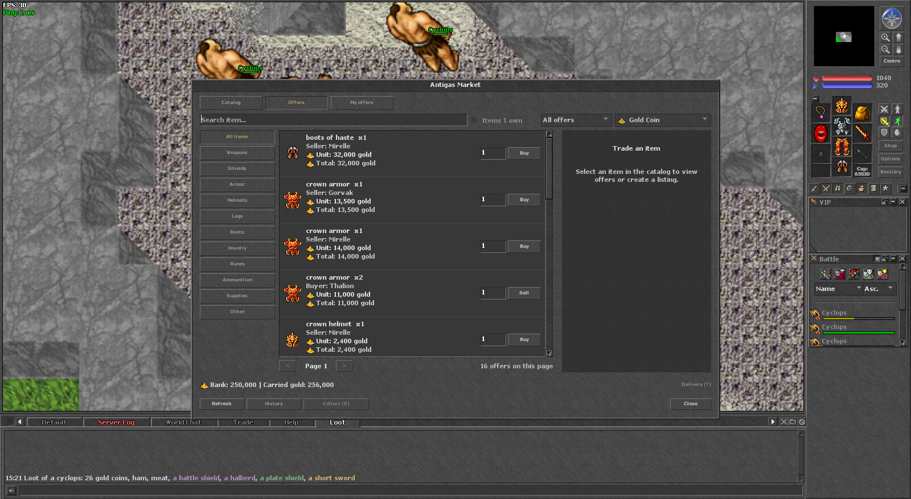
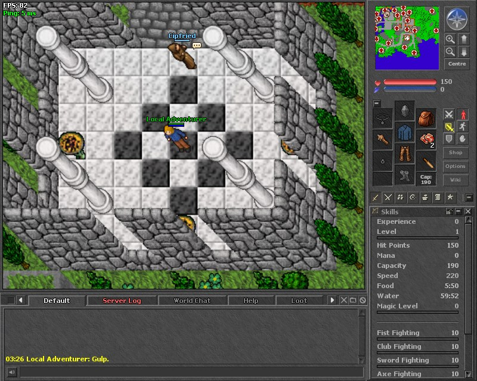
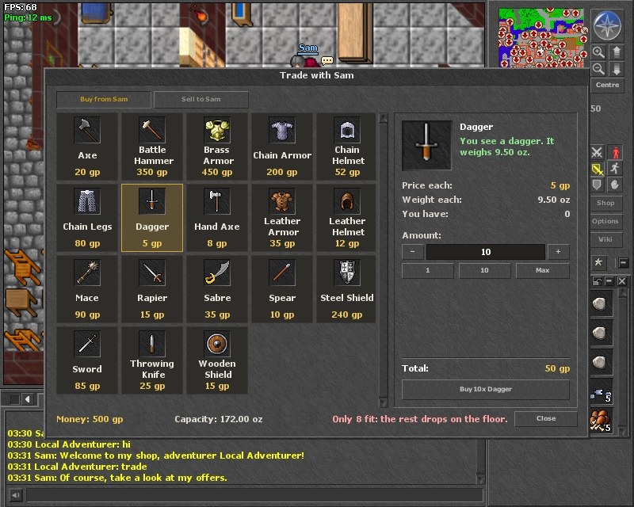
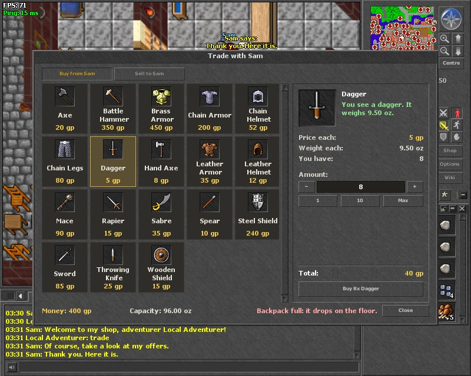
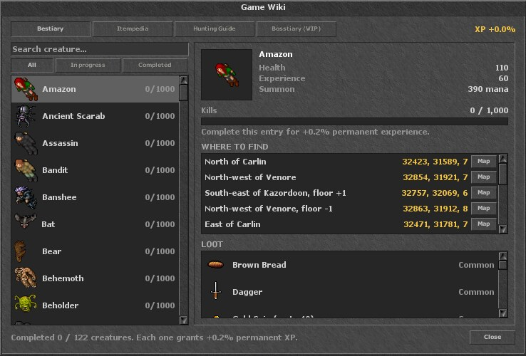
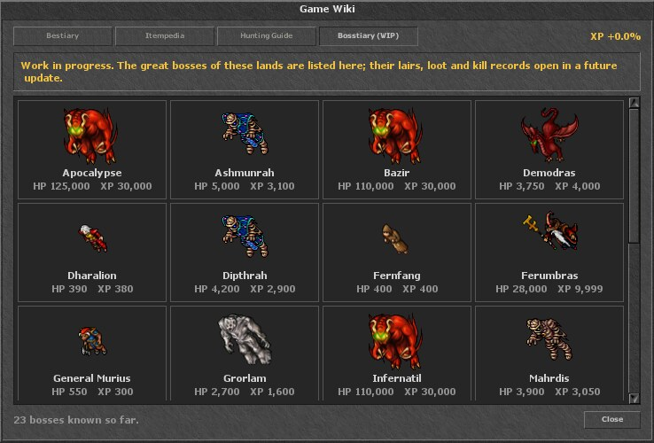

# Tibia 7.4 - A classic rpg version

[](https://github.com/djowww/tibia-7.4-a-classic-rpg-version/actions/workflows/security-build.yml)
[](https://github.com/djowww/tibia-7.4-a-classic-rpg-version/actions/workflows/codeql.yml)
[](https://discord.gg/CVneyh53mZ)
[](https://tibia74.tech/)

Servidor MMORPG independente inspirado em Tibia 7.4, anteriormente conhecido como **Antigas**. O repositório reúne o núcleo C++, scripts Lua, o cliente do projeto (OTClient, só OpenGL), o launcher e um ambiente localhost para desenvolvimento e testes.

**Site oficial:** [tibia74.tech](https://tibia74.tech/) · **Discord:** [discord.gg/CVneyh53mZ](https://discord.gg/CVneyh53mZ)

## Jogar agora

O servidor oficial está no ar. Crie sua conta no [site](https://tibia74.tech/index.php?jogar=1#criar-conta), baixe o [launcher](https://tibia74.tech/index.php?jogar=1#download) e entre no jogo. O [guia do jogador](https://tibia74.tech/wiki.php#guia) explica os primeiros passos. O launcher (versão atual: **v78**) baixa o cliente, confere as assinaturas e mantém tudo atualizado sozinho.

## Sobre esta versão

O objetivo é chegar o mais perto possível do Tibia 7.4 da época, nos sprites, no mapa e nos sistemas. O mapa voltou ao original do 7.4: áreas que não existiam na época (Yalahar, trainers, arenas, ilhas e construções extras) foram retiradas. A maior parte das fórmulas de combate, defesa, experiência e progressão foi baseada no código do servidor 7.72 que circula na comunidade, adaptada a este núcleo. As fórmulas estão em [Fórmulas de dano e defesa](docs/combat-formulas.md) e as diferenças conhecidas em relação ao 7.4 em [Compatibilidade com Tibia 7.4](docs/classic-74-compatibility.md).

## Novidades

- **Trade com NPCs:** diga `hi` e depois `trade` para abrir uma janela com os itens que o NPC compra e vende, com preço, peso e quantidade. Preços e falas continuam os mesmos do diálogo.
- **Balão de conversa nos NPCs:** um balão aparece sobre os NPCs; clique direito (ou o balão) cumprimenta o NPC. Na lista de batalha, NPCs têm barra azul.
- **Minimapa completo com marcações:** o mapa inteiro já vem explorado no cliente, com as marcações das cidades, templos, depots e lojas.
- **Andar com ping alto:** pré-walk de 2 passos e margem extra no mapa, sem bordas pretas, para andar com fluidez mesmo com ping acima de 100 ms.
- **Água e comida por até 1 hora:** beber água dá uma regeneração leve de mana por uma hora, e a comida acumula até 60 minutos. O tempo restante das duas aparece na janela de Skills, nas linhas Food e Water.
- **Trade avisa antes de faltar espaço:** a janela de trade mostra a capacidade e avisa quando a compra não cabe no peso ou na mochila, ou quando o troco vai cair no chão.
- **Labirinto e alavanca do mapa original:** o labirinto do subsolo perto de 33073,32603 e a alavanca de 32862,32312 voltaram a funcionar como no 7.4.
- **Cliente só OpenGL e wide screen:** o cliente agora usa apenas OpenGL (o launcher apaga os arquivos DirectX antigos), com tela larga e botão do Discord.
- **Bônus de XP e skills** de volta, junto com os bônus de achievements e bestiary.
- **Game Wiki (em desenvolvimento):** um livro dentro do cliente com Bestiary, Itempedia, Hunting Guide e Bosstiary.

## Imagens

Capturas feitas com o cliente do projeto.

| | |
| --- | --- |
|  |  |
|  |  |
|  |  |
|  |  |
|  | |

### Game Wiki

Aberta pelo botão **Wiki**, ao lado do inventário. Cada criatura leva ao mapa e aos itens que dropa, e cada item leva de volta às criaturas e aos NPCs que o compram ou vendem.

| | |
| --- | --- |
|  |  |
|  |  |

## Testar no seu computador

Baixe o [pacote local para Windows](https://github.com/djowww/tibia-7.4-a-classic-rpg-version/releases/tag/local-test-v2), extraia e abra **Tibia74-Local.exe**, com o Docker Desktop instalado. O pacote inclui o cliente; ao usar o repositório, o iniciador baixa e verifica o cliente automaticamente.

| Conta | Senha | Personagem |
| --- | --- | --- |
| `2` | `local123` | `Local Adventurer` |
| `1` | `1` | `Dev` (GM, para testes) |

Servidor e cliente usam **127.0.0.1**, nas portas **17173/17174**. Banco e chaves são preparados automaticamente, sem dados da produção. A primeira inicialização compila o servidor e pode demorar vários minutos; exige internet. Ao fechar o jogo, o servidor local é parado sem apagar o progresso.

Veja o [guia do ambiente local](local/README.md) para requisitos, persistência e diagnóstico. Não é necessário configurar o site ou os pagamentos para jogar localmente.

## Sistemas do projeto

O núcleo utiliza C++11 e LuaJIT, com extensões para o cliente customizado. A inspiração é clássica, com sistemas próprios; não se trata de uma reprodução integral das regras históricas. Use o cliente distribuído pelo projeto para manter a compatibilidade.

- **Market:** ofertas de compra e venda em Gold e Antigas Coins, negociações parciais, histórico e coleta de entregas.
- **Achievements e Bestiary:** conquistas com recompensas e progresso persistente por personagem, além de contadores de abates de monstros que dão bônus de experiência.
- **Diário de quests:** missões e etapas reveladas conforme as descobertas do personagem, com busca e filtros.
- **Raridade de equipamentos:** cinco tiers de raridade, atributos adicionais e identificação visual no inventário, nos containers e no chão.
- **Loot:** canal dedicado com cores por raridade e avisos para o dono do loot e sua party.
- **NPCs:** janela de trade, balão de conversa e cumprimento com clique direito.

Consulte o [guia dos sistemas](docs/systems.md) para conhecer as regras e integrações.

## Estrutura do repositório

| Caminho | Conteúdo |
| --- | --- |
| `src/` | Núcleo C++: mundo, combate, rede, persistência e APIs Lua. |
| `data/` | Scripts Lua, NPCs, monstros, itens, definições XML e mapa. |
| `data/sql/` | Estrutura e migrações do Market. |
| `deploy/` | Fontes do cliente, launcher Windows, portal web e ferramentas de implantação. |
| `tests/` | Testes e ferramentas de desenvolvimento. |
| `tools/` | Ferramentas de manutenção e preparação de releases. |
| `docs/` | Guias de compilação, sistemas e componentes complementares. |
| `local/` e `compose.yaml` | Instalação local, banco vazio, contas de teste e iniciador do cliente. |
| `config.example.lua` | Modelo de configuração para uma instalação própria. |

O servidor usa MySQL/MariaDB. O ambiente local inclui banco de demonstração e preparação por Docker Compose; o cliente completo é distribuído na release local. Os serviços privados do portal e de pagamentos ficam fora desse ambiente. O launcher de produção verifica assinaturas ECDSA e SHA-256. Consulte [compilação e configuração](docs/building.md) e [cliente, launcher e site](docs/client-and-web.md).

## Compilar o servidor

Em Linux, com CMake 3.16+, compilador C++11 e as dependências instaladas:

```sh
cmake -S . -B build -DCMAKE_BUILD_TYPE=Release
cmake --build build --parallel
```

As dependências incluem Boost System/Filesystem, LuaJIT, PugiXML, GMP e a biblioteca cliente MySQL/MariaDB. O [guia de compilação](docs/building.md) descreve os requisitos e a configuração necessária para executar o servidor.

## Participar

Leia o [guia de contribuição](CONTRIBUTING.md) para propor mudanças e a [política de segurança](SECURITY.md) para comunicar vulnerabilidades. Para conversar, tirar dúvidas ou relatar bugs, entre no [Discord](https://discord.gg/CVneyh53mZ). A origem do código e os avisos de licença estão em [NOTICE.md](NOTICE.md). Mais documentação em [docs/INDEX.md](docs/INDEX.md).

## Créditos e licenças

A manutenção e as adaptações deste projeto preservam a autoria das bases utilizadas:

- **CipSoft e os criadores de Tibia:** criação do jogo e do universo de referência. Este projeto é independente, sem vínculo oficial com a CipSoft.
- **Alejandro Mujica:** os cabeçalhos do núcleo identificam a base como **Tibia GIMUD Server**, com copyright de 2017 e termos GPL versão 2 ou posterior.
- **Comunidades OpenTibia e OTClient e colaboradores das distribuições utilizadas:** bases, ferramentas e conhecimento. O snapshot do cliente contém referências a OTClientV8; os avisos de cada componente permanecem nos arquivos.
- **rxi:** biblioteca JSON em Lua, distribuída sob licença MIT, com avisos originais preservados no servidor e no cliente.
- **Colaboradores e comunidade:** contribuições, testes e relatos registrados no [histórico de commits](https://github.com/djowww/tibia-7.4-a-classic-rpg-version/commits/main/) e na [lista de contribuidores](https://github.com/djowww/tibia-7.4-a-classic-rpg-version/graphs/contributors).

Consulte [NOTICE.md](NOTICE.md) e os cabeçalhos de cada arquivo para procedência e termos. Esses avisos não atribuem uma licença única a mapas, gráficos, músicas ou outros conteúdos de terceiros. O banner usa capturas do próprio cliente do projeto.
