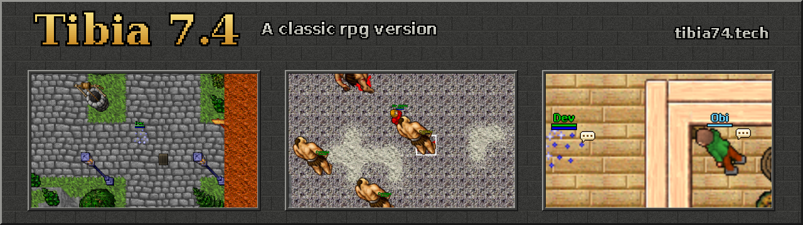
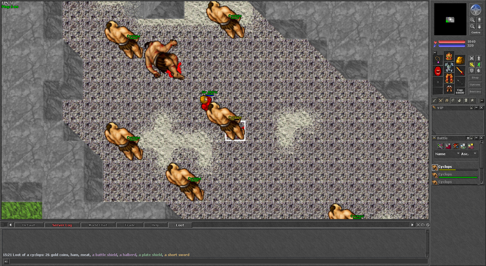
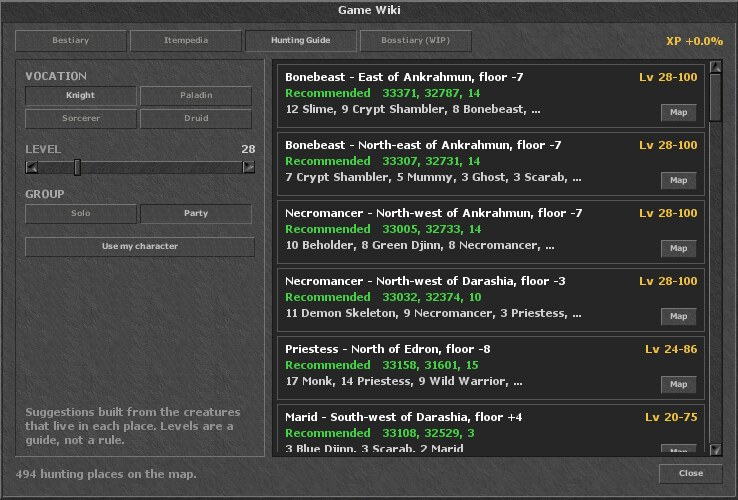
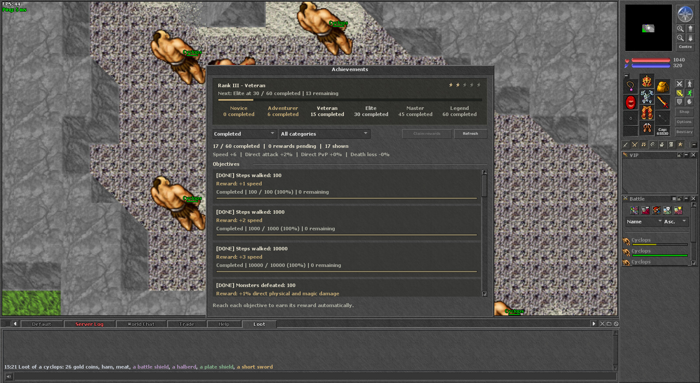
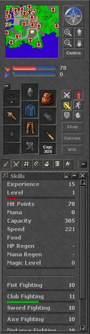
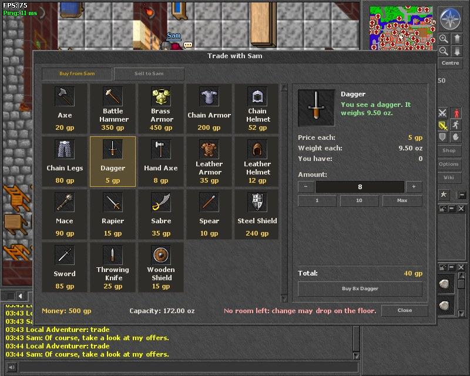
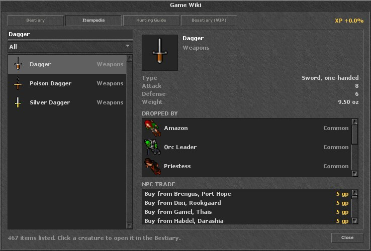

# Tibia 7.4 - A classic rpg version

[](https://discord.gg/CVneyh53mZ)
[](https://tibia74.tech/)
[](LICENSE)

Servidor MMORPG independente inspirado em Tibia 7.4. O repositório reúne o núcleo C++, os scripts Lua, os módulos do cliente do projeto (OTClient, só OpenGL), o launcher, o site e um ambiente localhost para desenvolvimento e testes.

O servidor se chama **Antigas**, nome que aparece no launcher, no cliente e na moeda do jogo (Antigas Coins). *Tibia 7.4 - A classic rpg version* é o nome do projeto e deste repositório.

**Site oficial:** [tibia74.tech](https://tibia74.tech/) · **Discord:** [discord.gg/CVneyh53mZ](https://discord.gg/CVneyh53mZ)

> **English summary:** Antigas is an independent open-source MMORPG server inspired by Tibia 7.4, with the original 7.4 map and 7.72-based formulas plus its own systems (Market, Achievements, Bestiary, item rarity, an in-client Game Wiki and exploration chests). It runs on a GIMUD/TFS-based C++ core with LuaJIT and a custom OTClient (OpenGL). Play at [tibia74.tech](https://tibia74.tech/), try it on localhost with the Windows package below, or build the server from source. Most documentation is in Portuguese; questions are welcome on [Discord](https://discord.gg/CVneyh53mZ).

## Jogar agora

O servidor oficial está no ar. Crie sua conta no [site](https://tibia74.tech/index.php?jogar=1#criar-conta), baixe o [launcher](https://tibia74.tech/index.php?jogar=1#download) e entre no jogo. O [guia do jogador](https://tibia74.tech/wiki.php#guia) explica os primeiros passos.

O launcher (versão atual: **v78**) baixa o cliente, confere as assinaturas e mantém tudo atualizado sozinho. Precisa de Windows e de uma placa de vídeo com OpenGL.

## O que tem de diferente

**Fiel ao 7.4.** O objetivo é chegar o mais perto possível do Tibia 7.4 da época, nos sprites, no mapa e nos sistemas. O mapa voltou ao original: áreas que não existiam na época (Yalahar, trainers, arenas, ilhas e construções extras) foram retiradas. A maior parte das fórmulas de combate, defesa, experiência e progressão vem do código do servidor 7.72 que circula na comunidade, adaptada a este núcleo. A luz é sempre a do jogo, sem opção de clarear a tela. Veja as [fórmulas de dano e defesa](docs/combat-formulas.md) e as [diferenças conhecidas em relação ao 7.4](docs/classic-74-compatibility.md).

**Sistemas próprios.** A inspiração é clássica, mas o servidor tem sistemas que não existiam na época:

- **Market:** ofertas de compra e venda em Gold e Antigas Coins, negociações parciais, histórico e coleta de entregas.
- **Achievements e Bestiary:** conquistas com recompensas e contadores de abates que dão bônus de experiência.
- **Raridade de equipamentos:** cinco tiers, atributos adicionais e identificação visual no inventário, nos containers e no chão, com canal **Loot** colorido por raridade.
- **Game Wiki:** livro dentro do cliente com Bestiary, Itempedia e Hunting Guide.
- **Baús de exploração:** um baú escondido por região dá um bônus permanente ao personagem que o encontra.
- **Diário de quests** e **NPCs** com janela de trade, balão de conversa e cumprimento com clique direito.

Consulte o [guia dos sistemas](docs/systems.md) para as regras de cada um. Use o cliente distribuído pelo projeto para manter a compatibilidade.

## Imagens

Capturas feitas com o cliente do projeto (Game Wiki e Skills atualizadas em novembro de 2026).

| | |
| --- | --- |
|  |  |
|  |  |

<details>
<summary>Mais imagens</summary>

| | |
| --- | --- |
|  |  |
|  |  |
|  |  |
|  |  |

</details>

## Novidades

**Chegando no próximo update** (já na `main`, ainda não no servidor oficial):

- **Launcher novo com Guardian:** confere os arquivos do cliente e avisa a equipe sobre bots conhecidos abertos no PC.
- **Tela de personagem nova** com o personagem em destaque no templo da cidade dele.
- **Raridade com aura de fundo** no slot e halo suave no chão.
- **NPCs falam sozinhos** (rumores e dicas de quest) e **luzes das cidades** acesas a noite toda.
- **Noite de caça:** à noite no jogo, os monstros dão mais XP e loot e nascem mais rápido, mas batem mais forte.
- **Cansaço por criatura, preço dinâmico nos NPCs e ouro 1x:** caçar sempre o mesmo monstro ou vender muito do mesmo item rende cada vez menos.
- **Recompensa por PK** (`!bounty`) e **aluguel semanal** das casas.
- **Dia e noite** com amanhecer e entardecer, e **save automático** a cada 5 minutos.
- **Baús de exploração:** um baú escondido em cada região. Quem encontra escolhe um bônus permanente para o personagem: ouro, mana ou vida.
- **Barras de skill** mais discretas na janela Skills, que agora também mostra de onde vem a regeneração de vida e mana.
- **Luz clássica:** iluminação sempre ligada, como no 7.4, e tochas com o dobro da duração.
- **Detecção de bots:** o servidor identifica comportamento automatizado e avisa a equipe.

**Já no servidor oficial:**

- **Trade com NPCs:** diga `hi` e depois `trade` para abrir uma janela com preço, peso e quantidade. A janela avisa quando a compra não cabe no peso ou na mochila.
- **Minimapa completo com marcações** de cidades, templos, depots e lojas.
- **Água e comida por até 1 hora,** com o tempo restante na janela de Skills.
- **Game Wiki (em desenvolvimento)** e bônus de XP e skills de volta.

O histórico completo está no [CHANGELOG](CHANGELOG.md).

## Testar no seu computador

Baixe o [pacote local para Windows](https://github.com/djowww/tibia-7.4-a-classic-rpg-version/releases/tag/local-test-v2), extraia e abra **Tibia74-Local.exe**, com o Docker Desktop instalado. O pacote inclui o cliente; ao usar o repositório, o iniciador baixa e verifica o cliente automaticamente pelo SHA-256. O código do iniciador está em [`local/launcher/Tibia74Local.cs`](local/launcher/Tibia74Local.cs).

| Conta | Senha | Personagem |
| --- | --- | --- |
| `2` | `local123` | `Local Adventurer` |
| `1` | `1` | `Gamemaster on Antigas` (GOD, para testes) |

Servidor e cliente usam **127.0.0.1**, nas portas **17173/17174**. Banco e chaves são preparados automaticamente, sem dados da produção. A primeira inicialização compila o servidor e pode demorar vários minutos; exige internet. Ao fechar o jogo, o servidor local é parado sem apagar o progresso.

Veja o [guia do ambiente local](local/README.md) para requisitos, persistência e diagnóstico. Não é necessário configurar o site ou os pagamentos para jogar localmente.

## Para desenvolvedores

### Estrutura do repositório

| Caminho | Conteúdo |
| --- | --- |
| `src/` | Núcleo C++: mundo, combate, rede, persistência e APIs Lua. |
| `data/` | Scripts Lua, NPCs, monstros, itens, definições XML e mapa. Os scripts próprios do projeto ficam nas subpastas `custom/` de cada tipo (por exemplo `data/creaturescripts/scripts/custom/` e `data/lib/custom/`). |
| `data/sql/` | Estrutura e migrações do Market. |
| `client/` | Módulos, layouts e estilos do cliente do projeto. Não é uma distribuição completa do OTClient. |
| `launcher/` | Código do launcher Windows e script de empacotamento do cliente. |
| `site/` | Páginas PHP do site, traduções e manifesto público de downloads. |
| `local/` e `compose.yaml` | Ambiente localhost: banco vazio, contas de teste e iniciador do cliente. |
| `tests/` | Testes separados por linguagem (`cpp/`, `lua/`, `python/`, `php/`, `launcher/`). |
| `tools/` | Geradores (Game Wiki, minimapa, catálogo de quests), lint e assinatura de releases. |
| `infra/` | Configurações e scripts de servidor web para uma infraestrutura específica. |
| `docs/` | Guias de compilação, sistemas e componentes complementares. |
| `config.example.lua` | Modelo de configuração para uma instalação própria. |

O servidor usa MySQL/MariaDB. O ambiente local inclui banco de demonstração e preparação por Docker Compose; o cliente completo é distribuído na release local. Os serviços privados do portal e de pagamentos ficam fora desse ambiente. O launcher de produção verifica assinaturas ECDSA e SHA-256. Consulte [compilação e configuração](docs/building.md) e [cliente, launcher e site](docs/client-and-web.md).

### Compilar o servidor

Em Linux, com CMake 3.16+, compilador C++11 e as dependências instaladas:

```sh
cmake -S . -B build -DCMAKE_BUILD_TYPE=Release
cmake --build build --parallel
```

As dependências incluem Boost System/Filesystem, LuaJIT, PugiXML, GMP e a biblioteca cliente MySQL/MariaDB. O [guia de compilação](docs/building.md) descreve os requisitos e a configuração necessária para executar o servidor.

### Rodar os testes

Da raiz do repositório:

```sh
# Python: código, dados, workflows e este README
PYTHONPATH=tests/python python3 -m unittest discover -s tests/python -p "test_*.py"

# Lua: scripts do servidor e módulos do cliente
luajit tests/lua/achievements-tests.lua

# C++: ative as suítes com as opções TFS_BUILD_*_TESTS do CMake
cmake -S . -B build -DTFS_BUILD_RARITY_TESTS=ON -DTFS_BUILD_CLASSIC_RULES_TESTS=ON
cmake --build build --parallel
ctest --test-dir build --output-on-failure
```

O [guia dos testes](tests/README.md) explica cada pasta.

## Participar

Leia o [guia de contribuição](CONTRIBUTING.md) para propor mudanças e a [política de segurança](SECURITY.md) para comunicar vulnerabilidades. Para conversar, tirar dúvidas ou relatar bugs, entre no [Discord](https://discord.gg/CVneyh53mZ) ou abra uma [issue](https://github.com/djowww/tibia-7.4-a-classic-rpg-version/issues/new/choose). Mais documentação em [docs/INDEX.md](docs/INDEX.md).

## Créditos e licenças

A manutenção e as adaptações deste projeto preservam a autoria das bases utilizadas:

- **CipSoft e os criadores de Tibia:** criação do jogo e do universo de referência. Este projeto é independente, sem vínculo oficial com a CipSoft.
- **Alejandro Mujica:** os cabeçalhos do núcleo identificam a base como **Tibia GIMUD Server**, com copyright de 2017 e termos GPL versão 2 ou posterior.
- **Comunidades OpenTibia e OTClient e colaboradores das distribuições utilizadas:** bases, ferramentas e conhecimento. O cliente contém referências a OTClientV8; os avisos de cada componente permanecem nos arquivos.
- **rxi:** biblioteca JSON em Lua, distribuída sob licença MIT, com avisos originais preservados no servidor e no cliente.
- **Colaboradores e comunidade:** contribuições, testes e relatos registrados no [histórico de commits](https://github.com/djowww/tibia-7.4-a-classic-rpg-version/commits/main/) e na [lista de contribuidores](https://github.com/djowww/tibia-7.4-a-classic-rpg-version/graphs/contributors).

O código do servidor é distribuído sob a [GPL versão 2 ou posterior](LICENSE). Consulte [NOTICE.md](NOTICE.md) e os cabeçalhos de cada arquivo para procedência e termos. Esses avisos não atribuem uma licença única a mapas, gráficos, músicas ou outros conteúdos de terceiros. O banner usa capturas do próprio cliente do projeto.
